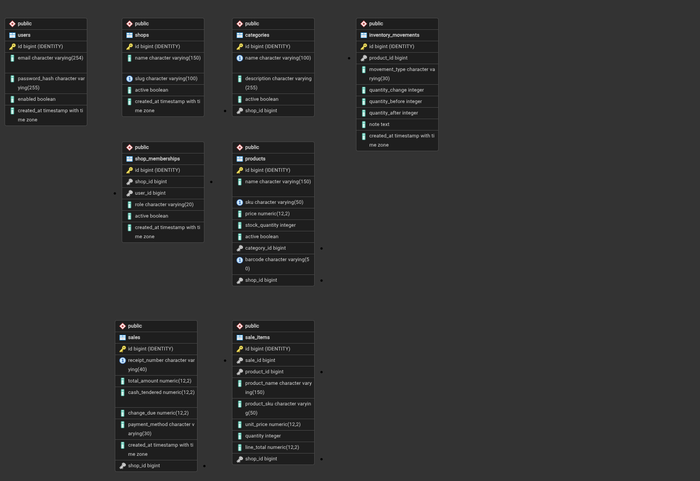

# RetailPOS

A multi-tenant Point of Sale backend built with Java, Spring Boot and PostgreSQL.

RetailPOS is a Point of Sale system designed for small retail businesses. It provides a centralized backend for managing products, tracking inventory and processing sales across multiple devices within the same shop.

The application focuses on reliable transaction processing, secure shop-level data isolation and maintaining accurate inventory records.

**The project is still under development.** The core backend features are in place, and I'm working towards making it a complete, deployable application.

## Features

### Implemented

- **Authentication** – User registration and login with JWT-based authentication.
- **Shop membership** – Users can own shops, with membership-based access control.
- **Tenant isolation** – Users can only access shops they have permission to use.
- **Category management** – Create and retrieve product categories.
- **Product management** – Create products with SKU, barcode, pricing and stock information.
- **Inventory tracking** – Record stock movements, including quantity changes and before/after stock levels.
- **Cash checkout** – Process sales, calculate totals and change, and automatically deduct inventory.
- **Transaction management** – Ensure failed checkouts don't leave partially updated inventory or incomplete sales.
- **Database migrations** – Manage database schema changes with Flyway.
- **Integration testing** – Test application behaviour against PostgreSQL using Testcontainers.

### Planned

- Sales history and receipt details.
- Staff management and role-based permissions.
- Daily sales summaries and reporting.
- Barcode scanning workflow.
- Returns and void transactions.
- Docker-based development and deployment.
- CI/CD pipeline with GitHub Actions.
- Public deployment.

## Tech Stack

| Area | Technology |
|---|---|
| Language | Java 21 |
| Framework | Spring Boot 4.1.2 |
| Build tool | Maven |
| Database | PostgreSQL 16 |
| ORM | Spring Data JPA / Hibernate |
| Database migrations | Flyway |
| Authentication | Spring Security, JWT |
| Validation | Jakarta Bean Validation |
| Testing | JUnit, MockMvc, AssertJ |
| Integration testing | Testcontainers |
| Version control | Git |


## Database Design

The following diagram shows the current PostgreSQL database schema and its relationships.



## Architecture

The application follows a layered architecture, keeping HTTP handling, business logic and database access separate.

```text
Client
  |
  v
REST Controllers
  |
  v
Service Layer
  |
  v
Repository Layer
  |
  v
PostgreSQL
```

- **Controllers** handle incoming HTTP requests, validation and responses.
- **Services** contain business logic and transaction boundaries.
- **Repositories** handle database operations using Spring Data JPA.
- **Entities** represent the application's persistent data.
- **DTOs** define the API request and response structures.
- **Security** handles authentication and shop-level access verification.

## Authentication & Tenant Isolation

RetailPOS supports multiple shops within a single application and database.

Users authenticate using JWT access tokens. Each shop has its own membership records, which determine which users can access it.

Requests to protected shop-specific endpoints include:

```http
Authorization: Bearer <access-token>
X-Shop-Id: <shop-id>
```

The backend verifies the authenticated user's active membership in the requested shop before establishing the shop context for that request.

This ensures that changing the shop ID in a request cannot grant access to another shop's data.

## Checkout & Inventory Integrity

Checkout is one of the more important parts of a POS system. A sale shouldn't be recorded if the inventory updates fail, and a failed checkout shouldn't leave the database in an inconsistent state.

The checkout process currently:

1. Retrieves the requested products belonging to the active shop.
2. Acquires pessimistic write locks on the products.
3. Checks product availability and stock quantities.
4. Calculates the sale total, cash tendered and change due.
5. Creates the sale and its associated sale items.
6. Deducts the purchased quantities from inventory.
7. Records inventory movements for the sale.

The operation runs inside a database transaction. If a product has insufficient stock, the checkout fails and the transaction is rolled back.

Products are also locked in a consistent order to reduce the risk of deadlocks when concurrent checkouts involve multiple products.

## API Overview

The following endpoints are currently implemented:

| Method | Endpoint | Description |
|---|---|---|
| POST | `/api/auth/register` | Register a user and create a shop |
| POST | `/api/auth/login` | Authenticate a user |
| GET | `/api/categories` | Retrieve categories |
| POST | `/api/categories` | Create a category |
| POST | `/api/products` | Create a product |
| POST | `/api/checkout` | Process a cash checkout |

Protected shop-specific endpoints require a valid JWT and an `X-Shop-Id` header.

More detailed API documentation will be added with OpenAPI/Swagger as the project progresses.

## Running Locally

### Prerequisites

- Java 21
- PostgreSQL 16
- Git
- Docker (for integration tests)

### 1. Clone the repository

```bash
git clone https://github.com/Axizeaus/retailpos.git
cd retailpos
```

### 2. Set up PostgreSQL

Create a PostgreSQL database and an application user, then grant the user access to the database.

Flyway will automatically apply the database migrations when the application starts.

### 3. Configure environment variables

The application expects the following environment variables:

```bash
export DB_URL=jdbc:postgresql://localhost:5432/retailpos
export DB_USERNAME=retailpos_user
export DB_PASSWORD=your_database_password
export JWT_SECRET="$(openssl rand -base64 32)"
```

The JWT secret should be a randomly generated Base64-encoded value containing at least 256 bits of key material.

Keep actual credentials and secrets out of version control.

### 4. Run the application

```bash
./mvnw spring-boot:run
```

The application starts on port `8080` by default.

Flyway handles schema migrations, while Hibernate validates the database schema on startup.

## Running Tests

Run the test suite with:

```bash
./mvnw test
```

Integration tests use Testcontainers to start a PostgreSQL 16 container, so they run against a separate test database rather than modifying the local development database.

Current integration test coverage includes:

- Application context initialization.
- User registration and login.
- Access to a user's own shop.
- Rejection of cross-tenant access.
- Required shop header validation.
- Successful cash checkout.
- Inventory deduction and movement recording.
- Insufficient-stock rejection.
- Multi-product checkout rollback.

## Development Roadmap

- [x] Authentication and JWT security
- [x] Shop membership and tenant isolation
- [x] Category management
- [x] Product creation
- [x] Inventory tracking
- [x] Cash checkout
- [x] Checkout transaction integrity
- [ ] Sales history and receipt retrieval
- [ ] Staff management and permissions
- [ ] Sales reporting
- [ ] Barcode workflow
- [ ] Returns and void transactions
- [ ] OpenAPI / Swagger documentation
- [ ] Docker setup
- [ ] GitHub Actions CI/CD
- [ ] Public deployment

## Repository

[GitHub – Axizeaus/retailpos](https://github.com/Axizeaus/retailpos)

---

Project status: Under active development. Core authentication, product management, inventory tracking and cash checkout are implemented.